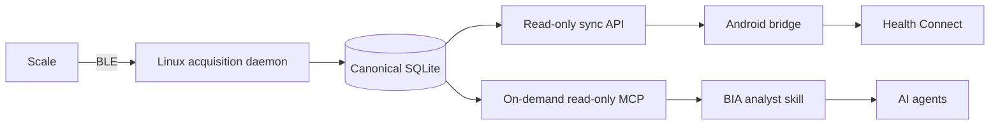

# Project map

Tracky is a local-first system for the `TS-CS10B` / `TR-CS10B` scale.

## Data flow

Linux is the sole BLE and wire-protocol owner. MCP and Android are projections over Linux-owned observations.

## Layout

| Path | Role |
| --- | --- |
| `linux/src/tracky_mcp/ble/` | BlueZ transport and device matching |
| `linux/src/tracky_mcp/protocol/` | Transport-free frame decoding and handshake state |
| `linux/src/tracky_mcp/acquisition/` | Acquisition lifecycle and persistence coordination |
| `linux/src/tracky_mcp/storage/` | Canonical SQLite records and evidence |
| `linux/src/tracky_mcp/daemon.py` | Always-on acquisition process |
| `linux/src/tracky_mcp/sync_server.py` | Android-facing observation endpoint; replacement contract pending |
| `linux/src/tracky_mcp/mcp/` | Agent-facing MCP adapter; read-only conversion pending |
| `linux/fixtures/` | Sanitized protocol evidence and decoder goldens |
| `android/` | Health Connect bridge; legacy direct-BLE code pending removal |
| `skills/bia-analyst/` | Read-only agent workflow over MCP evidence |
| `contracts/` | Cross-component schemas, identity, cursor, and idempotency rules |
| `context/PROTOCOL.md` | Evidence grades and protocol knowledge |
| `context/DEPLOYMENT.md` | Target runtime topology and deployment gates |
| `.pi/todos/` | Live implementation state and acceptance criteria |

## Ownership boundaries

### Linux

Own BLE discovery, GATT, handshake writes, frame capture, wire decoding, measurement quality, session lifecycle, stable source identifiers, and canonical persistence.

### MCP and skill

Read Linux history on demand. Present evidence and supported interpretations to agents. They do not scan, connect, acquire, recover daemon operations, or mutate canonical records.

### Android

Synchronize observations, read height from Health Connect, collect required profile inputs unavailable there, run only validated versioned derivations, and idempotently project supported records into Health Connect. Keep only the minimum import ledger. Android is neither an acquisition client nor a backup.

## Current migration boundary

The repository layout and documentation reflect the target ownership model. Current code still contains conflicting implementation that the open todos remove:

- Android BLE, protocol, evidence-store, manual weigh-in, and unsupported metric code.
- MCP acquisition/configuration tools and acquisition-service startup recovery.
- A lossy and insufficiently secured sync endpoint.
- A Linux daemon scanner mode, completion policy, and systemd unit that are not deployment-ready.

Read `todo list` for current work rather than expanding this file into a status log.
