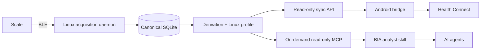

# Project map

Tracky is a local-first system for the `TS-CS10B` / `TR-CS10B` scale.

## Data flow

Linux is the sole BLE, wire-protocol, and derivation owner. MCP and Android are projections over Linux-owned observations; derivation runs when they read, so stored evidence can always be re-derived.

## Layout

| Path | Role |
| --- | --- |
| `linux/src/tracky_mcp/ble/` | BlueZ transport and device matching |
| `linux/src/tracky_mcp/protocol/` | Transport-free frame decoding and handshake state |
| `linux/src/tracky_mcp/acquisition/` | Acquisition lifecycle and persistence coordination |
| `linux/src/tracky_mcp/storage/` | Canonical SQLite records and evidence |
| `linux/src/tracky_mcp/derivation.py` | Versioned body-composition derivation and Linux profile |
| `linux/src/tracky_mcp/daemon.py` | Always-on acquisition process |
| `linux/src/tracky_mcp/sync_server.py` | Authenticated, read-only Android observation endpoint |
| `linux/src/tracky_mcp/mcp/` | Agent-facing on-demand, read-only MCP adapter |
| `linux/systemd/`, `linux/deploy/` | Service units and the idempotent appliance installer |
| `linux/fixtures/` | Sanitized protocol evidence and decoder goldens |
| `android/` | Non-launcher Health Connect writer, secure sync, WorkManager, and minimal import ledger |
| `skills/bia-analyst/` | Read-only agent workflow over MCP evidence |
| `contracts/` | Cross-component schemas, identity, cursor, and idempotency rules |
| `context/PROTOCOL.md` | Evidence grades and protocol knowledge |
| `context/DERIVATION.md` | Derivation inputs, algorithm, gates, and Health Connect mapping |
| `context/DEPLOYMENT.md` | Installed runtime topology and operations |
| `.pi/todos/` | Live implementation state and acceptance criteria |

## Ownership boundaries

### Linux

Own BLE discovery, GATT, handshake writes, frame capture, wire decoding, measurement quality, session lifecycle, stable source identifiers, canonical persistence, the user profile, and body-composition derivation.

### MCP and skill

Read Linux history and derived composition on demand. Present evidence and supported interpretations to agents. They do not scan, connect, acquire, recover daemon operations, or mutate canonical records.

### Android

Synchronize Linux observations and write weight and Linux-derived composition to Health Connect idempotently. Android derives nothing, reads nothing from Health Connect, and keeps only the import ledger. It is a non-launcher integration surface, not an acquisition client or backup.

Read `todo list` for current work rather than expanding this file into a status log.
